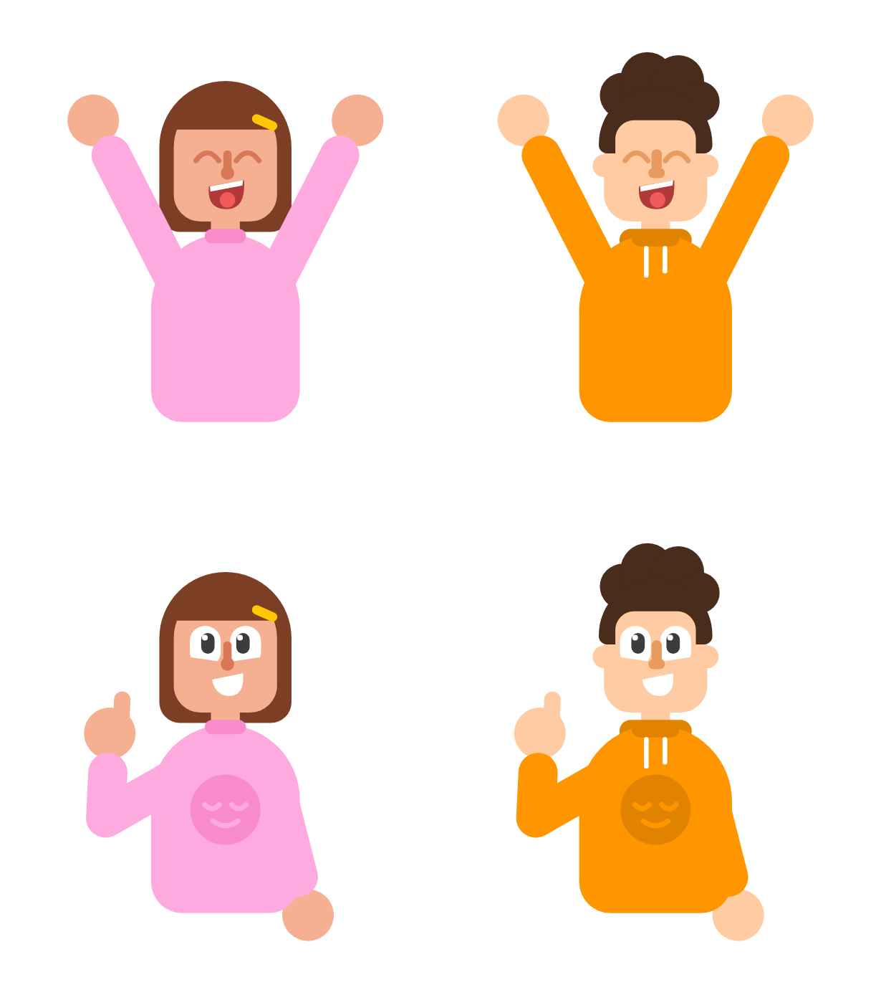

# Duolingo-style characters

A Claude skill that draws people in Duolingo's flat illustration style, using rules and proportions measured from the vector drawings in Duolingo's own brand guide.

## Install

- **Claude Code:** copy the `duolingo-character-style` folder into `~/.claude/skills/` (every project) or into `.claude/skills/` inside one project.
- **Claude apps (web or desktop):** in Settings, under Capabilities, find Skills and upload `duolingo-character-style.zip`.

Claude loads the skill on its own when you ask for a Duolingo-style character. You can also name it: "use the duolingo-character-style skill".

## Why use it?

Agents draw people with the wrong proportions: stick arms, beads for hands, a ball sitting on the shoulder, three thin fingers plus a thumb on every hand, a torso like a sack.

This skill measures the real numbers off Duolingo's own brand guide — head width, arm thickness, hand size, the shoulder's hidden seat, the shape of the eyes — and ships a table of mistakes already made, with the fix for each. The result reads as the same hand, pose after pose.

## Try it

- "Draw an SVG of a boy in a green hoodie giving a thumbs up, Duolingo style."
- "Make a React Native SVG of a tired student at a desk holding her head."
- "Review this character and tell me what breaks the Duolingo style."

## Reference

- **[SKILL.md](./SKILL.md)** — the rules, the proportions table, a checklist and the mistakes to avoid.
- **[reference/measurements.md](./reference/measurements.md)** — the raw numbers and quotes from the guide.
- **[reference/kit.mjs](./reference/kit.mjs)** — a small JavaScript kit (Node 18+, no dependencies) that draws two example characters in nine poses.
- **[reference/render-sheet.mjs](./reference/render-sheet.mjs)** — a contact sheet of every pose. Run `node reference/render-sheet.mjs out` and open `out/sheet.svg`.

## Note

This is a style guide for drawing original characters. Duolingo's own characters (Duo, Lily and the rest) and its logo are Duolingo's trademarks; the skill tells Claude not to copy them.
